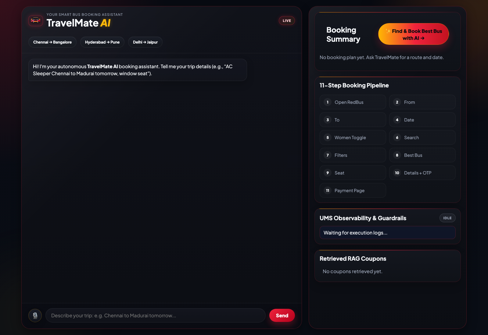
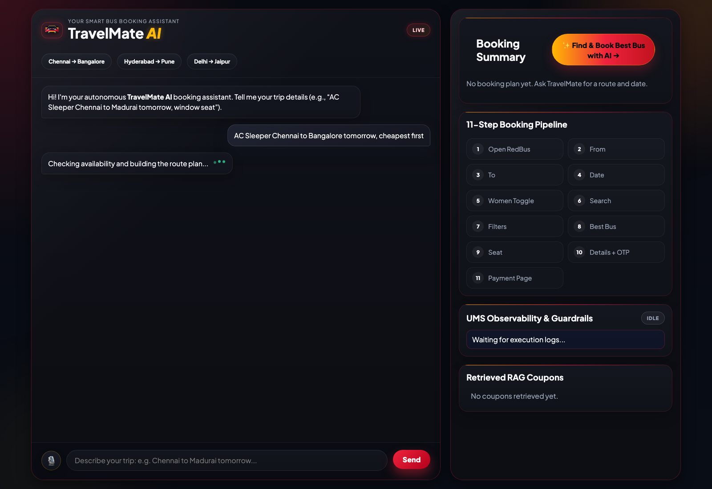

# TravelMate AI — RedBus Booking Agent

A demo AI travel assistant for RedBus that understands trip requests, builds a booking plan, and automates the booking flow in a browser while stopping safely at the OTP verification stage.

## Overview

This project combines:

- a FastAPI backend
- a browser-based chat UI
- a lightweight RAG / planning layer
- Playwright browser automation for RedBus
- guarded automation that stops before fake payment completion

The app is designed for safe human-in-the-loop booking assistance rather than automated payment fraud.

## Key Features

- Route and date extraction from natural-language queries
- Bus strategy ranking such as cheapest, fastest, best-rated, and balanced
- Local knowledge base for offers and pricing heuristics
- Live browser automation on RedBus
- Seat, boarding, traveler, and verification flow management
- Telemetry dashboard showing real execution progress and guardrails

## Screenshots

### Homepage



### Booking summary and pipeline



## Tech Stack

- Python
- FastAPI
- Playwright
- Google Gemini
- Pydantic
- HTML/CSS/JavaScript

## How to Run

### 1. Clone the repository

```bash
git clone https://github.com/Hemal-31/redbus-genai-agent.git
cd redbus-genai-agent
```

### 2. Create and activate a virtual environment

```bash
python3 -m venv .venv
source .venv/bin/activate
```

### 3. Install dependencies

```bash
pip install -r backend/requirements.txt
python -m playwright install --with-deps chromium
```

### 4. Add your Gemini API key

Copy the sample config and fill in your own key:

```bash
cp backend/.env.example backend/.env
```

Then edit [backend/.env.example](backend/.env.example) and save it as [backend/.env](backend/.env):

```env
GEMINI_API_KEY=your_google_gemini_api_key_here
GEMINI_LLM_MODEL=gemini-2.5-flash
GEMINI_EMBEDDING_MODEL=gemini-embedding-2
```

### 5. Start the app

```bash
python -m uvicorn backend.main:app --host 127.0.0.1 --port 8000
```

Then open:

```text
http://127.0.0.1:8000/
```

## Example Prompts

```text
AC Sleeper Chennai to Bangalore tomorrow, cheapest first
Hyderabad to Pune this Friday, prefer fastest travel time
Best rated bus from Coimbatore to Madurai with front-seat preference
```

## Safety Notes

This project intentionally stops before payment or fake booking completion. It waits for real OTP/mobile verification and allows the user to confirm the next human step.

## Project Structure

```text
redbus-genai-agent/
├── backend/
│   ├── data/
│   ├── __init__.py
│   ├── .env.example
│   ├── browser_agent.py
│   ├── main.py
│   ├── rag_engine.py
│   └── requirements.txt
├── docs/
│   └── screenshots/
│       ├── homepage.png
│       └── booking-summary.png
├── extension/
├── frontend/
│   ├── app.js
│   ├── images/
│   ├── index.html
│   └── style.css
├── tests/
│   └── test_browser_preferences.py
├── .gitignore
├── pytest.ini
├── README.md
└── scratch/
```

## License

This project is intended for learning, prototyping, and safe AI-assistive travel automation experiments.

---

If you want, this repo can also be extended with a deployment setup for Docker, Vercel, or a secure FastAPI production config.

```bash
python3 backend/main.py
```

Or with uvicorn:

```bash
PYTHONPATH=. python3 -m uvicorn backend.main:app --host 127.0.0.1 --port 8000
```

Then open:

```text
http://127.0.0.1:8000/
```

---

## Example booking flow

A normal booking request goes through the following path:

1. User says: "AC Sleeper Chennai to Bangalore tomorrow, cheapest first"
2. The planner extracts:
   - source: Chennai
   - destination: Bangalore
   - date: tomorrow
   - bus type: Sleeper + AC
   - preference: CHEAPEST
3. The planner scores candidate offers and builds the plan.
4. The backend enqueues the browser automation task.
5. Playwright opens RedBus and fills the search form.
6. The app chooses the cheapest available bus that still matches route quality and review/rating heuristics.
7. It tries to select a seat according to the seat preference.
8. It fills boarding and dropping points.
9. It fills the passenger details and waits for OTP/manual confirmation.
10. The process stops safely before payment.

---

## Important behavior and constraints

- This app is designed to be realistic, not deceptive.
- It will not fake payment or confirmation.
- It pauses at OTP / payment verification to keep the user in control.
- The browser automation is real and interacts with the live site under the same constraints as a normal user.
- Seat selection is preference-aware, but the live RedBus DOM may change, so the selector logic is intentionally robust and defensive.
- The app relies on a local offer knowledge base and optionally Gemini for better planning quality.

---

## Why the design is agentic

This project is not just a static chatbot. It contains a planning layer and an execution layer:

- Planning layer: interprets user intent, route, date, and preference
- RAG layer: ranks offers and trip strategy using known data
- Action layer: uses a browser to perform the booking workflow in the real site
- Safety layer: stops before payment and requires user verification when the process reaches OTP or the final transaction step

That makes it an autonomous booking assistant rather than a simple prompt-response tool.

---

## Current phase

This repository is currently in Phase 1, focusing on:

- route extraction and travel planning
- real browser automation against RedBus
- profile collection and booking data preparation
- careful wait points before OTP/payment
- deterministic and safe booking flow behavior without fake finalization

Future phases can expand the system with:

- more robust seat map matching across RedBus layout variations
- stronger multi-step traveler memory and saved profiles
- more nuanced route and bus ranking logic
- a cleaner frontend automation dashboard and booking history
